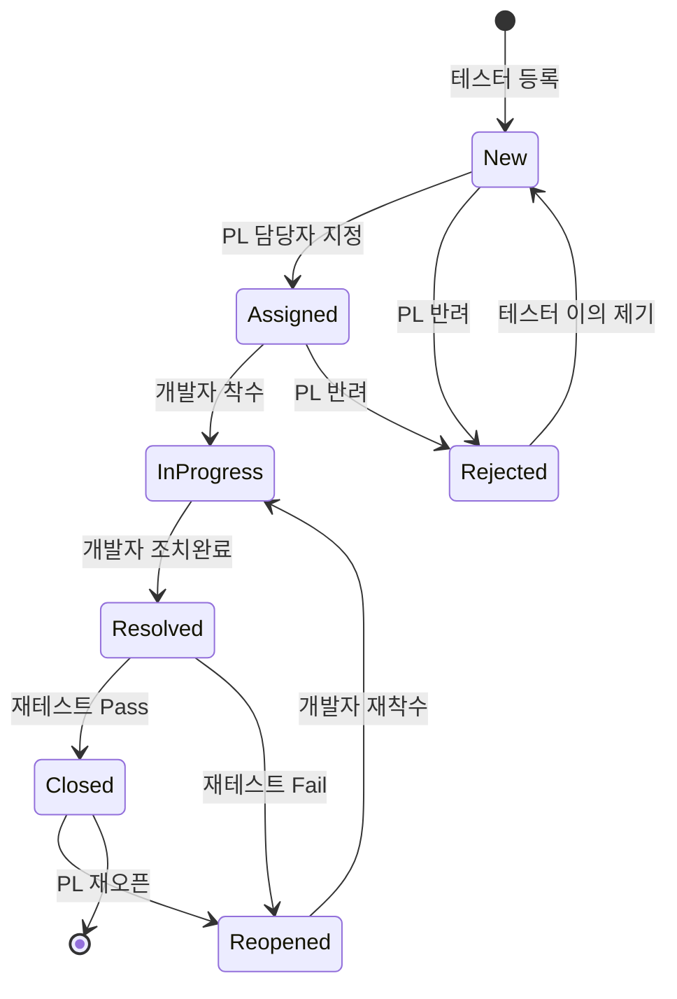

# 테스트 이슈 관리 시스템 - 기능정의서

| 항목 | 내용 |
|---|---|
| 문서명 | 기능정의서 |
| 시스템명 | 테스트 이슈 관리 시스템 (TIMS, Test Issue Management System) |
| 버전 | v0.1 (초안) |
| 작성일 | 2026-10-16 |

### 개정 이력

| 버전 | 일자 | 작성자 | 내용 |
|---|---|---|---|
| v0.1 | 2026-10-16 | - | 최초 작성 |
| v0.2 | 2026-10-17 | - | 테스트케이스 관리(F11) 추가, 이슈 등록 시 테스트케이스 선택 필수화 |

---

## 1. 개요

### 1.1 목적
SI 프로젝트의 단위테스트·통합테스트에서 발견된 이슈(결함)를 한곳에 등록하고, 담당자 지정부터 조치, 재테스트, 종료까지의 진행 상황을 추적한다. 테스트 종료 시점에 미결 이슈가 남아 있는지 확인하고, 산출물인 결함관리대장을 엑셀로 바로 출력할 수 있게 한다.

### 1.2 범위

| 구분 | 내용 |
|---|---|
| 포함 | 이슈 등록·조회·수정, 상태 관리(워크플로우), 조치 등록, 재테스트 결과 등록, 코멘트, 변경 이력, 현황 대시보드, 엑셀 내보내기/가져오기, 사용자·코드 설정, 단위·통합 테스트케이스 목록 관리 및 이슈 연결 |
| 제외 | 테스트케이스 수행 결과 관리(Pass/Fail·수행일), 시나리오 관리, 요구사항 추적, 로그인·인증, 메일·메신저 알림, DB 사용 |

### 1.3 전제 및 제약
- 데이터베이스를 사용하지 않고 서버의 JSON 파일(`data/issues.json`)에 저장한다.
- 프로젝트 팀 내부망에서 사용하며, 동시 사용자는 30명 이하, 이슈 건수는 프로젝트당 5,000건 이하를 가정한다.
- 로그인 없이 화면 상단에서 사용자를 선택하는 방식으로 사용자를 식별한다. 역할에 따른 권한 제한은 업무 실수 방지 목적이며 보안 통제 수단이 아니다.
- 지원 브라우저: Chrome, Edge 최신 버전

### 1.4 용어 정의

| 용어 | 설명 |
|---|---|
| 이슈 | 테스트 중 발견된 결함, 개선 요청, 문의 사항을 통칭 |
| 단위테스트(UT) | 프로그램(화면, 배치, API) 단위로 개발자 또는 테스터가 수행하는 테스트 |
| 통합테스트(IT) | 여러 프로그램·업무·연계 시스템을 묶어 시나리오 기준으로 수행하는 테스트 |
| 조치 | 개발자가 이슈의 원인을 분석하고 소스·설정·데이터를 수정한 행위 |
| 재테스트 | 조치가 끝난 이슈를 테스터가 다시 확인하는 행위 |
| 조치율 | (종료 + 반려) 건수 / 전체 건수 x 100 |
| 미결 이슈 | 종료·반려가 아닌 상태의 이슈 |

---

## 2. 사용자 및 역할

| 역할 | 코드 | 설명 | 주요 업무 |
|---|---|---|---|
| 테스터 | TESTER | 테스트를 수행하는 사람(현업, QA, 개발자 교차 테스트 포함) | 이슈 등록, 재테스트, 반려 이의 제기 |
| 개발자 | DEVELOPER | 이슈를 조치하는 사람 | 착수, 조치 등록, 조치완료 처리 |
| PL/PM | MANAGER | 업무 리더, 프로젝트 관리자 | 담당자 지정, 반려, 모든 상태 강제 변경, 설정 관리, 엑셀 가져오기 |

- 한 사용자는 하나의 역할만 가진다.
- 코멘트 작성과 조회, 엑셀 내보내기는 모든 역할이 할 수 있다.

---

## 3. 기능 목록

| 기능 ID | 기능명 | 설명 | 사용 역할 | 화면 | 우선순위 |
|---|---|---|---|---|---|
| F01 | 이슈 등록 | 테스트 중 발견한 이슈를 등록 | 전체 | SCR-03 | 필수 |
| F02 | 이슈 목록/검색 | 조건별 이슈 조회, 정렬, 페이징 | 전체 | SCR-02 | 필수 |
| F03 | 이슈 상세/수정 | 이슈 정보, 조치, 재테스트, 이력 조회 및 수정 | 전체 | SCR-03, SCR-04 | 필수 |
| F04 | 상태 관리 | 정해진 워크플로우에 따른 상태 전이 | 역할별 | SCR-04 | 필수 |
| F05 | 조치 등록 | 원인 분석 및 조치 내용 기록 | 개발자, PL/PM | SCR-04 | 필수 |
| F06 | 재테스트 | 조치 결과 확인(Pass/Fail) | 테스터, PL/PM | SCR-04 | 필수 |
| F07 | 코멘트/변경 이력 | 의견 교환 및 변경 사항 자동 기록 | 전체 | SCR-04 | 필수 |
| F08 | 현황 대시보드 | 상태별·심각도별·담당자별 집계, 장기 미조치 목록 | 전체 | SCR-01 | 필수 |
| F09 | 엑셀 내보내기/가져오기 | 결함관리대장 출력, 기존 대장 일괄 등록 | 내보내기 전체, 가져오기 PL/PM | SCR-02, SCR-05 | 필수 |
| F10 | 사용자/코드 설정 | 사용자, 모듈, 코드값 관리 | PL/PM | SCR-06 | 선택 |
| F11 | 테스트케이스 관리 | 단위·통합 테스트케이스 등록·수정, 엑셀 일괄 등록, 연결 이슈 조회 | 등록·수정 테스터·PL/PM, 삭제·가져오기 PL/PM | SCR-07, SCR-08 | 필수 |

---

## 4. 기능 상세

### F01. 이슈 등록

**설명**: 테스터가 테스트 중 발견한 이슈를 등록한다. 등록 즉시 상태는 `신규`가 되며, PL/PM이 등록하면서 담당자를 지정하면 바로 `접수` 상태가 된다.

**입력 항목**

| 항목 | 필수 | 형식 | 설명 |
|---|---|---|---|
| 테스트구분 | O | 선택(단위/통합) | ID 채번 기준(UT/IT) |
| 테스트 차수 | | 선택(1차/2차/3차...) | 통합테스트 회차 구분 |
| 이슈유형 | O | 선택(결함/개선/문의) | 기본값: 결함 |
| 업무/모듈 | O | 선택 | 설정(F10)의 모듈 목록 |
| 화면·프로그램 ID | | 텍스트(50자) | 예: `SCR-ORD-001`, `OrderService` |
| 테스트케이스 | O | 선택(F11에 등록된 사용 중 케이스) | 테스트구분이 같은 케이스만 선택 가능 |
| 제목 | O | 텍스트(200자) | 이슈를 한 줄로 요약 |
| 재현 절차 | O | 여러 줄 텍스트(4,000자) | 화면 진입부터 이슈 발생까지 단계별 기술 |
| 기대 결과 | O | 여러 줄 텍스트(2,000자) | |
| 실제 결과 | O | 여러 줄 텍스트(2,000자) | 오류 메시지 포함 |
| 테스트 환경 | | 선택(개발/테스트/스테이징) | 기본값: 테스트 |
| 심각도 | O | 선택(치명/높음/보통/낮음) | 정의는 5장 참조 |
| 우선순위 | O | 선택(긴급/높음/보통/낮음) | 기본값: 보통 |
| 발견자 | O | 사용자 | 기본값: 현재 사용자 |
| 발견일 | O | 날짜 | 기본값: 오늘, 미래 날짜 불가 |
| 담당자 | | 사용자(개발자) | PL/PM만 입력 가능, 지정 시 상태 `접수` |
| 조치 기한 | | 날짜 | 미입력 시 심각도별 기본 기한 자동 계산 |
| 첨부파일 | | 파일(최대 5개, 개당 10MB) | 스크린샷, 로그 파일 |

**처리 규칙**
- 이슈 ID는 테스트구분별로 순차 채번한다: 단위 `UT-0001`, 통합 `IT-0001`.
- 테스트케이스를 선택하면 업무/모듈, 화면·프로그램 ID를 케이스 값으로 채운다. 재현 절차(케이스의 사전조건 + 테스트 절차)와 기대 결과는 비어 있으면 채우고, 이미 입력돼 있으면 덮어쓸지 확인한다.
- 테스트구분을 바꾸면 구분이 다른 테스트케이스 선택은 해제된다.
- v0.2 이전에 텍스트로 기록된 테스트케이스 ID는 그대로 유지하며, 해당 이슈를 수정할 때 테스트케이스를 바꾸지 않으면 다른 항목은 수정할 수 있다.
- 조치 기한을 비워 두면 발견일 기준으로 심각도별 기본 기한을 적용한다(치명 1일, 높음 3일, 보통 5일, 낮음 10일, 영업일이 아닌 달력일 기준).
- 등록 완료 후 이슈 상세 화면으로 이동한다.

### F02. 이슈 목록/검색

**설명**: 등록된 이슈를 조건으로 검색하고 목록으로 본다.

**검색 조건**: 테스트구분, 테스트 차수, 상태(복수 선택), 심각도(복수 선택), 이슈유형, 모듈, 담당자, 발견자, 테스트케이스, 발견일 기간, 기한 초과 여부, 키워드(ID·제목·재현 절차·화면ID·테스트케이스ID 대상)

**목록 항목**: ID, 구분, 모듈, 화면ID, 제목, 심각도, 우선순위, 상태, 발견자, 담당자, 발견일, 조치 기한, 경과일

**처리 규칙**
- 기본 조건: 미결 이슈(종료·반려 제외), 발견일 내림차순, 페이지당 20건
- 모든 컬럼으로 정렬할 수 있다.
- 조치 기한을 넘긴 미결 이슈는 빨간색으로 표시한다.
- "내 담당", "내가 등록", "재테스트 대기" 빠른 필터를 제공한다.
- 현재 검색 조건 그대로 엑셀로 내보낼 수 있다(F09).
- 검색 조건은 URL 쿼리에 반영하여 링크로 공유할 수 있다.

### F03. 이슈 상세/수정

**설명**: 이슈 하나의 모든 정보를 탭으로 나누어 보여주고 수정한다.

**처리 규칙**
- 기본정보는 등록자, 담당자, PL/PM이 수정할 수 있다. 단, `종료`·`반려` 상태 이슈는 PL/PM만 수정할 수 있다.
- 이슈 ID, 테스트구분, 등록일시는 수정할 수 없다.
- 다른 사용자가 먼저 수정한 경우 저장하지 않고 "다른 사용자가 먼저 수정했습니다. 새로고침 후 다시 시도하세요" 메시지를 보여준다.
- 이슈 삭제는 PL/PM만 할 수 있으며, 실제 삭제하지 않고 삭제 표시만 한다(목록에서 숨김).

### F04. 상태 관리

**설명**: 이슈는 아래 상태 흐름에 따라서만 상태를 바꿀 수 있다.

**상태 정의**

| 상태 | 코드 | 설명 | 다음 행동 주체 |
|---|---|---|---|
| 신규 | NEW | 등록되었으나 담당자 미지정 | PL/PM |
| 접수 | ASSIGNED | 담당자 지정됨, 조치 착수 전 | 개발자 |
| 조치중 | IN_PROGRESS | 개발자가 분석·수정 중 | 개발자 |
| 조치완료 | RESOLVED | 조치 완료, 재테스트 대기 | 테스터 |
| 재오픈 | REOPENED | 재테스트 실패 또는 종료 후 재발 | 개발자 |
| 종료 | CLOSED | 재테스트 통과 | - |
| 반려 | REJECTED | 중복, 이슈 아님, 범위 외로 판단 | 테스터(이의 시) |

**처리 규칙**
- 역할별로 허용된 전이만 버튼으로 보여준다. 전이별 허용 역할과 필수 입력값은 상세설계서 4장에 정의한다.
- PL/PM은 상태 흐름과 관계없이 상태를 강제로 바꿀 수 있으며, 이때 사유 입력은 필수다.
- 반려 시 반려 사유(중복/이슈 아님/범위 외/재현 불가)를 선택해야 하며, 중복이면 원본 이슈 ID를 입력한다.
- 모든 상태 변경은 변경 이력(F07)에 남는다.

### F05. 조치 등록

**설명**: 개발자가 이슈의 원인과 조치 내용을 기록한다. 조치 정보가 있어야 `조치완료`로 바꿀 수 있다.

**입력 항목**

| 항목 | 필수 | 형식 | 설명 |
|---|---|---|---|
| 원인 분류 | O | 선택 | 코딩오류 / 설계오류 / 요구사항 누락·변경 / 환경·설정 / 데이터 / 연계시스템 / 기타 |
| 원인 상세 | O | 여러 줄 텍스트(2,000자) | |
| 조치 내용 | O | 여러 줄 텍스트(4,000자) | |
| 수정 대상 | | 텍스트(1,000자) | 수정한 소스 파일, 설정, 테이블. 여러 개는 줄바꿈으로 구분 |
| 반영 버전 | | 텍스트(50자) | 커밋 ID, 빌드 번호, 배포 일자 |
| 조치자 | O | 사용자 | 기본값: 현재 사용자 |
| 조치일 | O | 날짜 | 기본값: 오늘 |

**처리 규칙**
- 재오픈 후 다시 조치하면 이전 조치 내역은 보존하고 새 조치 내역을 추가한다(조치 차수 1, 2, 3...).
- 조치 등록과 `조치완료` 전이는 한 번에 처리할 수 있다("조치 등록 후 완료 처리" 버튼).

### F06. 재테스트

**설명**: 테스터가 조치된 이슈를 다시 테스트하고 결과를 기록한다.

**입력 항목**: 결과(Pass/Fail, 필수), 확인 의견(Fail 시 필수, 2,000자), 확인자(기본값: 현재 사용자), 확인일(기본값: 오늘), 첨부파일

**처리 규칙**
- `조치완료` 상태에서만 등록할 수 있다.
- Pass이면 상태를 `종료`로, Fail이면 `재오픈`으로 자동 변경한다.
- 재테스트 결과는 누적 기록되며, 이슈별 재오픈 횟수를 집계한다.
- 기본적으로 발견자가 재테스트하며, 다른 테스터나 PL/PM도 할 수 있다.

### F07. 코멘트/변경 이력

**설명**: 이슈에 대한 의견을 주고받고, 모든 변경 사항을 자동으로 기록한다.

**처리 규칙**
- 코멘트: 모든 사용자가 작성할 수 있고, 본인 코멘트만 수정·삭제할 수 있다(삭제 시 "삭제된 코멘트입니다"로 표시).
- 변경 이력: 필드 값 변경, 상태 전이, 조치 등록, 재테스트, 첨부 추가·삭제를 "일시, 사용자, 항목, 변경 전, 변경 후" 형태로 자동 기록한다. 변경 이력은 수정·삭제할 수 없다.
- 상세 화면의 이력 탭에서 코멘트와 변경 이력을 시간순으로 함께 보여준다.

### F08. 현황 대시보드

**설명**: 테스트 진행 현황을 한눈에 파악한다. 주간보고, 테스트 종료 판정 자료로 활용한다.

**표시 항목**

| 영역 | 내용 |
|---|---|
| 요약 카드 | 전체, 미결, 조치완료(재테스트 대기), 종료, 반려 건수, 조치율, 기한 초과 건수 |
| 상태별 현황 | 상태별 건수(막대 차트) |
| 심각도 x 상태 | 심각도별 미결/종료 건수 교차표 |
| 모듈별 현황 | 모듈별 전체·미결·조치율 |
| 담당자별 현황 | 담당자별 접수·조치중·재오픈·기한 초과 건수 |
| 일자별 추이 | 일자별 발견 건수, 종료 건수, 누적 미결 건수(선 차트) |
| 장기 미조치 | 조치 기한 초과 또는 등록 후 N일(기본 7일) 이상 지난 미결 이슈 목록 |

**처리 규칙**
- 테스트구분(전체/단위/통합), 테스트 차수, 기간으로 필터링한다.
- 집계 표의 숫자를 누르면 해당 조건이 적용된 이슈 목록(F02)으로 이동한다.

### F09. 엑셀 내보내기/가져오기

**내보내기**
- 이슈 목록의 현재 검색 조건 결과를 결함관리대장 양식(.xlsx)으로 내려받는다.
- 시트 구성: `결함관리대장`(이슈 1건 1행, 최종 조치·재테스트 정보 포함), `현황요약`(대시보드 요약 수치)
- 파일명: `결함관리대장_{프로젝트명}_{yyyyMMdd}.xlsx`

**가져오기**
- PL/PM이 기존에 엑셀로 관리하던 결함관리대장을 일괄 등록한다.
- 업로드 후 미리보기 화면에서 행별 검증 결과(정상/오류와 오류 사유)를 확인한 뒤 정상 행만 등록한다.
- 엑셀에 ID가 있으면 기존 ID를 유지하고, 이미 존재하는 ID는 "건너뛰기" 또는 "덮어쓰기" 중 선택한다. ID가 없으면 새로 채번한다.
- 테스트케이스ID는 필수이며 F11에 등록된 사용 중 케이스이고 테스트구분이 같아야 한다. 테스트케이스를 먼저 가져온 뒤 이슈를 가져온다.
- 가져오기 양식 템플릿을 내려받을 수 있다.

### F10. 사용자/코드 설정

**설명**: 시스템에서 사용할 기본 정보를 관리한다. 설정은 `data/config.json` 파일에 저장한다.

| 설정 | 항목 |
|---|---|
| 프로젝트 정보 | 프로젝트명, 테스트 차수 목록 |
| 사용자 | 이름, 역할, 소속, 사용 여부 |
| 모듈 | 모듈 코드, 모듈명, 기본 담당 PL, 사용 여부 |
| 코드값 | 심각도별 기본 조치 기한, 장기 미조치 기준일 |

**처리 규칙**
- 이슈·테스트케이스에서 사용 중인 사용자·모듈은 삭제할 수 없고 "사용 안 함"으로만 바꿀 수 있다.
- 모듈에 기본 담당 PL을 지정하면, 신규 이슈 목록에서 해당 PL에게 "내 모듈 신규 이슈"로 표시한다.

### F11. 테스트케이스 관리

**설명**: 이슈가 등록되는 대상인 단위·통합 테스트케이스를 등록하고 관리한다. 데이터는 `data/testcases.json` 파일에 저장한다.

**입력 항목**

| 항목 | 필수 | 형식 | 설명 |
|---|---|---|---|
| 테스트케이스 ID | O | 영문·숫자·`-`·`_` 50자 | 사용자 입력, 중복 불가, 등록 후 변경 불가. 예: `TC-UT-ORD-012` |
| 테스트구분 | O | 선택(단위/통합) | |
| 업무/모듈 | O | 선택 | 설정(F10)의 모듈 목록 |
| 화면·프로그램 ID | | 텍스트(50자) | |
| 테스트명 | O | 텍스트(200자) | |
| 사전조건 | | 여러 줄 텍스트(2,000자) | |
| 테스트 절차 | O | 여러 줄 텍스트(4,000자) | |
| 기대 결과 | O | 여러 줄 텍스트(2,000자) | |
| 담당자 | | 사용자 | 작성·수행 담당자 |
| 사용 여부 | O | 예/아니오 | 기본값: 사용 |

**처리 규칙**
- 테스터와 PL/PM이 등록·수정하고, 삭제와 엑셀 가져오기는 PL/PM만 할 수 있다.
- 목록은 구분, 모듈, 사용 여부, 키워드(ID·테스트명·화면ID)로 검색하며, 케이스별 연결 이슈 수(미결/전체)를 보여준다. 숫자를 누르면 해당 케이스의 이슈 목록(F02)으로 이동한다.
- 이슈가 연결된 케이스는 삭제할 수 없고 "사용 안 함"으로만 바꿀 수 있다. 사용 안 함인 케이스는 이슈 등록 시 선택할 수 없다.
- 이슈가 연결된 케이스는 테스트구분을 바꿀 수 없다.
- 엑셀 가져오기는 F09와 같은 방식(양식 다운로드, 행별 검증 미리보기, 기존 ID 건너뛰기/덮어쓰기)으로 동작한다.

---

## 5. 코드 정의

### 5.1 심각도

| 코드 | 명칭 | 기준 | 기본 조치 기한 |
|---|---|---|---|
| CRITICAL | 치명 | 시스템 중단, 데이터 손상, 핵심 업무 진행 불가, 대안 없음 | 1일 |
| HIGH | 높음 | 주요 기능 오동작, 우회 방법은 있으나 업무 영향 큼 | 3일 |
| MEDIUM | 보통 | 일부 기능 오류, 업무 영향 제한적 | 5일 |
| LOW | 낮음 | 화면 문구, 정렬, UI 등 경미한 오류 | 10일 |

### 5.2 기타 코드

| 코드 그룹 | 값 |
|---|---|
| 테스트구분 | UT(단위), IT(통합) |
| 이슈유형 | DEFECT(결함), IMPROVEMENT(개선), QUESTION(문의) |
| 우선순위 | URGENT(긴급), HIGH(높음), MEDIUM(보통), LOW(낮음) |
| 테스트 환경 | DEV(개발), TEST(테스트), STAGING(스테이징) |
| 원인 분류 | CODING, DESIGN, REQUIREMENT, ENVIRONMENT, DATA, INTERFACE, ETC |
| 반려 사유 | DUPLICATE(중복), NOT_ISSUE(이슈 아님), OUT_OF_SCOPE(범위 외), CANNOT_REPRODUCE(재현 불가) |
| 재테스트 결과 | PASS, FAIL |

---

## 6. 비기능 요구사항

| 구분 | 요구사항 |
|---|---|
| 성능 | 이슈 5,000건 기준 목록 조회 1초 이내, 대시보드 2초 이내 |
| 데이터 안전성 | 저장 중 서버가 중단되어도 기존 데이터 파일이 손상되지 않을 것. 일 1회 및 서버 시작 시 자동 백업, 30일 보관 |
| 동시성 | 같은 이슈를 여러 명이 수정할 때 나중에 저장한 사람이 앞사람의 변경을 모르고 덮어쓰지 않을 것 |
| 이식성 | Node.js만 설치되어 있으면 별도 미들웨어 없이 실행. 데이터 폴더를 복사하면 그대로 이전 가능 |
| 사용성 | 이슈 등록은 필수 항목만 입력하면 1분 안에 끝낼 수 있을 것. 스크린샷은 붙여넣기(Ctrl+V)로 첨부 가능 |
