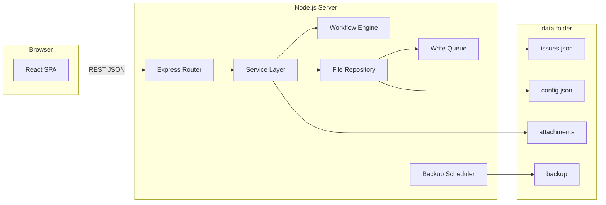
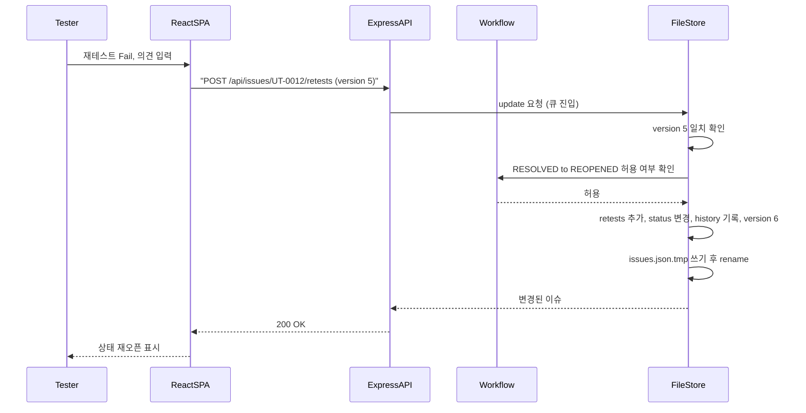
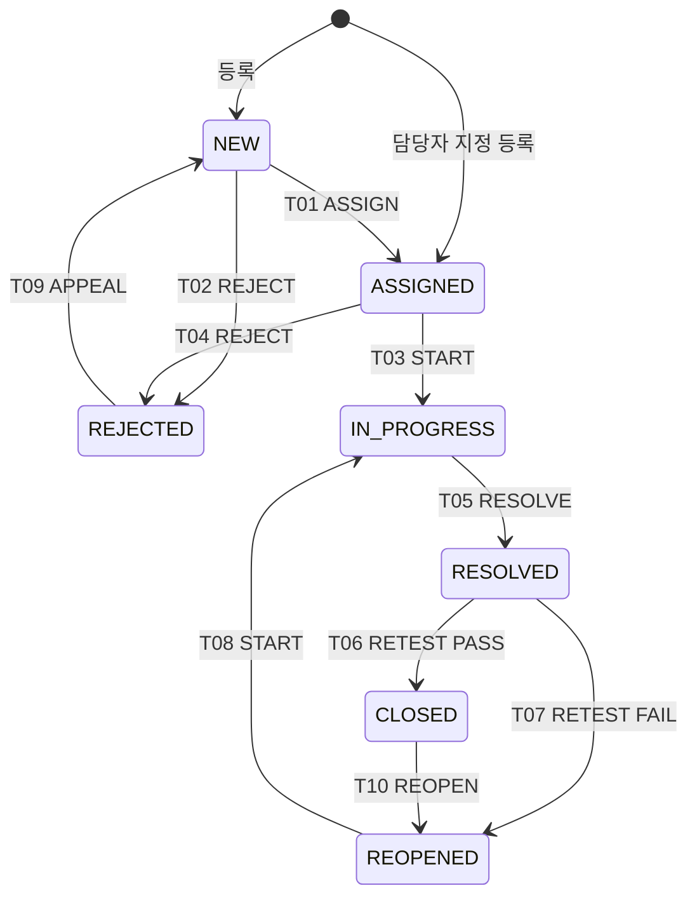

# 테스트 이슈 관리 시스템 - 상세설계서

| 항목 | 내용 |
|---|---|
| 문서명 | 상세설계서 |
| 시스템명 | 테스트 이슈 관리 시스템 (TIMS) |
| 버전 | v0.1 (초안) |
| 작성일 | 2026-10-16 |
| 참조 문서 | [01_기능정의서.md](01_기능정의서.md) |

### 개정 이력

| 버전 | 일자 | 작성자 | 내용 |
|---|---|---|---|
| v0.1 | 2026-10-16 | - | 최초 작성 |
| v0.2 | 2026-10-17 | - | 테스트케이스 관리 추가(2.8, API-22~28, SCR-07·08), 이슈 testCaseId 참조 검증 |

### 목차
1. 아키텍처
2. 데이터 설계
3. 상태 전이 설계
4. API 설계
5. 화면 설계

---

## 1. 아키텍처

### 1.1 시스템 구성



- 서버 하나가 API와 빌드된 화면 정적 파일을 함께 제공한다(배포 단위 1개, 포트 1개).
- 서버는 시작 시 `issues.json`과 `config.json`을 메모리에 올리고, 조회는 메모리에서 처리한다. 변경이 생기면 메모리를 갱신한 뒤 파일에 쓴다.
- 서버 프로세스는 반드시 1개만 실행한다. 여러 프로세스가 같은 파일을 쓰면 데이터가 유실되므로, 시작 시 `data/.lock` 파일로 중복 실행을 막는다.

### 1.2 기술 스택

| 구분 | 기술 | 용도 |
|---|---|---|
| 런타임 | Node.js 20 LTS | 서버 실행 |
| 서버 | Express 4 | REST API, 정적 파일 제공 |
| 파일 업로드 | multer | 첨부파일, 엑셀 업로드 |
| 엑셀 | exceljs | 엑셀 읽기/쓰기 |
| 입력 검증 | zod | 요청 데이터 스키마 검증(서버·화면 공용) |
| 화면 | React 18 + Vite + TypeScript | SPA |
| 화면 라우팅/조회 | React Router, TanStack Query | 화면 이동, 서버 데이터 캐시 |
| UI 컴포넌트 | Ant Design | 표, 폼, 탭, 날짜 선택 |
| 차트 | Recharts | 대시보드 차트 |

### 1.3 폴더 구조

```text
tims/
├─ package.json
├─ server/
│  ├─ index.ts                 # 서버 시작, 잠금 파일, 백업 스케줄 등록
│  ├─ routes/
│  │  ├─ issues.ts             # /api/issues
│  │  ├─ stats.ts              # /api/stats
│  │  ├─ excel.ts              # /api/export, /api/import
│  │  ├─ attachments.ts        # /api/attachments
│  │  └─ config.ts             # /api/config
│  ├─ services/
│  │  ├─ issueService.ts       # 등록·수정·조회·검색
│  │  ├─ workflow.ts           # 상태 전이 규칙
│  │  ├─ statsService.ts       # 집계
│  │  └─ excelService.ts       # 엑셀 변환
│  ├─ repository/
│  │  ├─ fileStore.ts          # 원자적 쓰기, 쓰기 큐
│  │  ├─ issueRepository.ts
│  │  └─ configRepository.ts
│  ├─ backup.ts
│  └─ middleware/
│     ├─ currentUser.ts        # X-User-Id 헤더 해석
│     └─ errorHandler.ts
├─ shared/
│  ├─ codes.ts                 # 코드값 상수
│  ├─ schemas.ts               # zod 스키마
│  └─ transitions.ts           # 상태 전이표(서버·화면 공용)
├─ web/
│  ├─ index.html
│  └─ src/
│     ├─ pages/                # Dashboard, IssueList, IssueForm, IssueDetail, Import, Settings
│     ├─ components/
│     ├─ api/                  # API 호출 함수
│     └─ store/                # 현재 사용자 선택 상태
├─ logs/                       # 오류 로그(일별 파일)
└─ data/                       # 실행 시 생성, 백업 대상
   ├─ issues.json
   ├─ config.json
   ├─ attachments/
   │  └─ UT-0001/
   └─ backup/
```

### 1.4 파일 저장 설계

#### 1.4.1 원자적 쓰기
저장 도중 서버가 중단되어도 파일이 반쯤 쓰인 상태로 남지 않도록 아래 순서로 쓴다.

1. 메모리의 전체 데이터를 JSON 문자열로 변환한다(들여쓰기 2칸, UTF-8).
2. 같은 폴더의 임시 파일 `issues.json.tmp`에 쓰고 `fsync`로 디스크 반영을 보장한다.
3. `rename`으로 `issues.json`을 교체한다. 같은 볼륨 안의 rename은 원자적으로 처리된다.
4. Windows에서 백신 등이 파일을 잡고 있어 rename이 실패(`EPERM`, `EBUSY`)하면 100ms 간격으로 최대 5회 재시도한다. 끝내 실패하면 메모리 변경을 되돌리고 `500 STORAGE_WRITE_FAILED`를 응답한다.

#### 1.4.2 쓰기 큐
- 모든 변경 요청은 하나의 Promise 체인(쓰기 큐)에 순서대로 넣어 처리한다. 앞 요청의 파일 쓰기가 끝나야 다음 요청이 시작되므로 동시에 두 요청이 파일을 쓰지 않는다.
- 처리 순서: 큐 진입 -> 버전 확인 -> 메모리 데이터 복사본에 변경 적용 -> 파일 쓰기 -> 성공 시 메모리 교체 -> 응답
- 파일 쓰기에 실패하면 복사본을 버리므로 메모리와 파일이 어긋나지 않는다.

```ts
// fileStore.ts 핵심 구조
class FileStore<T> {
  private data: T;
  private queue: Promise<unknown> = Promise.resolve();

  read(): T { return this.data; }

  update<R>(mutator: (draft: T) => R): Promise<R> {
    const job = this.queue.then(async () => {
      const draft = structuredClone(this.data);
      const result = mutator(draft);   // 검증 실패 시 throw -> 파일 쓰지 않음
      await atomicWrite(this.path, draft);
      this.data = draft;
      return result;
    });
    this.queue = job.catch(() => undefined);
    return job;
  }
}
```

#### 1.4.3 낙관적 잠금
- 이슈마다 `version`(정수, 등록 시 1)을 둔다.
- 수정, 상태 전이, 조치·재테스트 등록 요청은 화면이 갖고 있던 `version`을 함께 보낸다.
- 서버는 쓰기 큐 안에서 저장된 `version`과 비교하여, 다르면 `409 VERSION_CONFLICT`를 응답한다. 같으면 변경 후 `version`을 1 올린다.
- 코멘트 등록은 다른 변경과 충돌하지 않으므로 버전 확인 없이 처리한다. 다만 이슈의 `version`은 올린다.

#### 1.4.4 백업
- 서버 시작 시, 그리고 매일 00:00에 `data/backup/issues_{yyyyMMdd_HHmmss}.json`, `config_{...}.json`으로 복사한다.
- 30일이 지난 백업 파일은 백업 시점에 삭제한다(보관 기간은 `config.json`에서 변경 가능).
- 첨부파일 폴더는 백업 대상이 아니다. 운영 시 `data/` 폴더 전체를 주기적으로 외부 저장소에 복사하도록 운영 가이드에 명시한다.
- 복구: 서버를 중지하고 원하는 백업 파일을 `data/issues.json`으로 복사한 뒤 서버를 시작한다.

#### 1.4.5 첨부파일 저장
- 저장 위치: `data/attachments/{이슈ID}/{첨부ID}_{원본파일명}`
- 첨부 ID는 UUID v4를 사용한다. 원본 파일명의 경로 문자(`/`, `\`, `..`)는 제거한다.
- 허용 확장자: png, jpg, jpeg, gif, bmp, txt, log, csv, xlsx, docx, pdf, zip
- 다운로드 시 `Content-Disposition: attachment`로 내려보내 브라우저에서 바로 실행되지 않게 한다.

### 1.5 사용자 식별
- 로그인이 없으므로 화면 상단에서 사용자를 선택하고, 선택한 사용자 ID를 브라우저 `localStorage`에 저장한다.
- 모든 API 요청은 `X-User-Id` 헤더에 사용자 ID를 담는다. 서버의 `currentUser` 미들웨어가 `config.json`에서 사용자와 역할을 찾아 요청 객체에 넣는다.
- 헤더가 없거나 사용하지 않는 사용자이면 조회 API는 허용하고 변경 API는 `401 USER_REQUIRED`를 응답한다.
- 이 방식은 실수 방지용이며, 내부망 전용으로 운영한다는 전제를 운영 가이드에 명시한다.

### 1.6 처리 흐름 예시: 재테스트 Fail 등록



---

## 2. 데이터 설계

### 2.1 파일 목록

| 파일 | 내용 | 변경 빈도 |
|---|---|---|
| `data/issues.json` | 이슈 전체, ID 채번 정보 | 높음 |
| `data/testcases.json` | 단위·통합 테스트케이스 목록 | 중간 |
| `data/config.json` | 프로젝트 정보, 사용자, 모듈, 설정값 | 낮음 |
| `data/attachments/{이슈ID}/` | 첨부파일 실물 | 중간 |
| `data/backup/` | 백업 파일 | 일 1회 |

### 2.2 issues.json 최상위 구조

```json
{
  "schemaVersion": 1,
  "sequences": { "UT": 128, "IT": 41 },
  "issues": [ { "...": "Issue 객체" } ]
}
```

| 필드 | 타입 | 설명 |
|---|---|---|
| schemaVersion | number | 파일 구조 버전. 구조가 바뀌면 서버 시작 시 마이그레이션 수행 |
| sequences | object | 테스트구분별 마지막 채번 번호 |
| issues | Issue[] | 이슈 목록(삭제 표시된 이슈 포함) |

### 2.3 Issue 객체

| 필드 | 타입 | 필수 | 설명 | 기능정의 항목 |
|---|---|---|---|---|
| id | string | O | `UT-0001` 형식, 변경 불가 | 이슈 ID |
| testType | `UT` \| `IT` | O | 변경 불가 | 테스트구분 |
| testRound | string \| null | | 예: `1차` | 테스트 차수 |
| issueType | `DEFECT` \| `IMPROVEMENT` \| `QUESTION` | O | | 이슈유형 |
| module | string | O | config 모듈 코드 | 업무/모듈 |
| programId | string | | 50자 이하 | 화면·프로그램 ID |
| testCaseId | string | O | 50자 이하. 등록 시 testcases.json의 사용 중 케이스이고 testType이 같아야 함(2.8). v0.2 이전 데이터는 빈 값 또는 미등록 텍스트일 수 있음 | 테스트케이스 |
| title | string | O | 200자 이하 | 제목 |
| steps | string | O | 4,000자 이하 | 재현 절차 |
| expected | string | O | 2,000자 이하 | 기대 결과 |
| actual | string | O | 2,000자 이하 | 실제 결과 |
| environment | `DEV` \| `TEST` \| `STAGING` | O | 기본 `TEST` | 테스트 환경 |
| severity | `CRITICAL` \| `HIGH` \| `MEDIUM` \| `LOW` | O | | 심각도 |
| priority | `URGENT` \| `HIGH` \| `MEDIUM` \| `LOW` | O | 기본 `MEDIUM` | 우선순위 |
| status | Status 코드 | O | 3장 참조 | 상태 |
| reporter | string | O | 사용자 ID | 발견자 |
| assignee | string \| null | | 사용자 ID(개발자) | 담당자 |
| foundDate | string | O | `YYYY-MM-DD` | 발견일 |
| dueDate | string | O | `YYYY-MM-DD`, 미입력 시 자동 계산 | 조치 기한 |
| rejection | Rejection \| null | | 반려 정보 | 반려 사유 |
| resolutions | Resolution[] | O | 조치 이력, 빈 배열로 시작 | 조치 내역 |
| retests | Retest[] | O | 재테스트 이력 | 재테스트 |
| attachments | Attachment[] | O | 이슈 본문 첨부 | 첨부파일 |
| comments | Comment[] | O | | 코멘트 |
| history | History[] | O | 자동 기록 | 변경 이력 |
| reopenCount | number | O | 재오픈 횟수, 기본 0 | |
| closedAt | string \| null | | 종료 일시(ISO 8601) | |
| deleted | boolean | O | 삭제 표시, 기본 false | |
| createdAt | string | O | ISO 8601 (`2026-10-16T21:00:00+09:00`) | 등록일시 |
| createdBy | string | O | 사용자 ID | |
| updatedAt | string | O | ISO 8601 | |
| version | number | O | 낙관적 잠금용, 1부터 시작 | |

#### 하위 객체

**Resolution (조치)**

| 필드 | 타입 | 필수 | 설명 |
|---|---|---|---|
| seq | number | O | 조치 차수(1, 2, 3...) |
| cause | `CODING` \| `DESIGN` \| `REQUIREMENT` \| `ENVIRONMENT` \| `DATA` \| `INTERFACE` \| `ETC` | O | 원인 분류 |
| causeDetail | string | O | 2,000자 이하 |
| action | string | O | 4,000자 이하 |
| changedFiles | string | | 1,000자 이하, 줄바꿈 구분 |
| buildVersion | string | | 50자 이하 |
| resolver | string | O | 사용자 ID |
| resolvedDate | string | O | `YYYY-MM-DD` |
| createdAt | string | O | ISO 8601 |

**Retest (재테스트)**

| 필드 | 타입 | 필수 | 설명 |
|---|---|---|---|
| seq | number | O | 재테스트 차수 |
| resolutionSeq | number | O | 확인 대상 조치 차수 |
| result | `PASS` \| `FAIL` | O | |
| comment | string | FAIL 시 O | 2,000자 이하 |
| tester | string | O | 사용자 ID |
| testedDate | string | O | `YYYY-MM-DD` |
| attachments | Attachment[] | O | |
| createdAt | string | O | ISO 8601 |

**Rejection (반려)**

| 필드 | 타입 | 필수 | 설명 |
|---|---|---|---|
| reason | `DUPLICATE` \| `NOT_ISSUE` \| `OUT_OF_SCOPE` \| `CANNOT_REPRODUCE` | O | |
| duplicateOf | string \| null | DUPLICATE 시 O | 원본 이슈 ID |
| comment | string | O | 1,000자 이하 |
| rejectedBy | string | O | 사용자 ID |
| rejectedAt | string | O | ISO 8601 |

**Attachment (첨부)**

| 필드 | 타입 | 설명 |
|---|---|---|
| id | string | UUID v4 |
| fileName | string | 원본 파일명 |
| size | number | 바이트 |
| mimeType | string | |
| uploadedBy | string | 사용자 ID |
| uploadedAt | string | ISO 8601 |

**Comment (코멘트)**

| 필드 | 타입 | 설명 |
|---|---|---|
| id | string | UUID v4 |
| author | string | 사용자 ID |
| body | string | 2,000자 이하 |
| createdAt / updatedAt | string | ISO 8601 |
| deleted | boolean | 삭제 표시 |

**History (변경 이력)**

| 필드 | 타입 | 설명 |
|---|---|---|
| at | string | ISO 8601 |
| user | string | 사용자 ID |
| action | `CREATE` \| `UPDATE` \| `TRANSITION` \| `RESOLVE` \| `RETEST` \| `ATTACH` \| `DETACH` \| `DELETE` \| `IMPORT` | 행위 |
| field | string \| null | 변경 필드명(UPDATE일 때) |
| from | string \| null | 변경 전 값 |
| to | string \| null | 변경 후 값 |
| note | string \| null | 강제 변경 사유 등 |

- 여러 줄 텍스트 필드(`steps`, `expected`, `actual`)는 이력에 전체 값을 남기지 않고 `from`/`to`에 앞 100자만 저장한다.

#### Issue 예시

```json
{
  "id": "UT-0012",
  "testType": "UT",
  "testRound": null,
  "issueType": "DEFECT",
  "module": "ORD",
  "programId": "SCR-ORD-003",
  "testCaseId": "TC-UT-ORD-021",
  "title": "주문 목록에서 기간 조회 시 종료일 당일 주문이 누락됨",
  "steps": "1. 주문관리 > 주문목록 진입\n2. 조회기간 2026-10-01 ~ 2026-10-15 입력\n3. 조회 클릭",
  "expected": "10월 15일 주문 포함 조회",
  "actual": "10월 14일까지만 조회됨",
  "environment": "TEST",
  "severity": "HIGH",
  "priority": "HIGH",
  "status": "REOPENED",
  "reporter": "u-tester01",
  "assignee": "u-dev03",
  "foundDate": "2026-10-15",
  "dueDate": "2026-10-18",
  "rejection": null,
  "resolutions": [
    {
      "seq": 1,
      "cause": "CODING",
      "causeDetail": "종료일 조건을 < 로 비교",
      "action": "종료일 + 1일 미만 조건으로 변경",
      "changedFiles": "OrderMapper.xml",
      "buildVersion": "a1b2c3d",
      "resolver": "u-dev03",
      "resolvedDate": "2026-10-16",
      "createdAt": "2026-10-16T10:12:00+09:00"
    }
  ],
  "retests": [
    {
      "seq": 1,
      "resolutionSeq": 1,
      "result": "FAIL",
      "comment": "엑셀 다운로드에서는 여전히 누락됨",
      "tester": "u-tester01",
      "testedDate": "2026-10-16",
      "attachments": [],
      "createdAt": "2026-10-16T15:40:00+09:00"
    }
  ],
  "attachments": [],
  "comments": [],
  "history": [
    { "at": "2026-10-15T14:00:00+09:00", "user": "u-tester01", "action": "CREATE", "field": null, "from": null, "to": null, "note": null },
    { "at": "2026-10-16T15:40:00+09:00", "user": "u-tester01", "action": "RETEST", "field": "status", "from": "RESOLVED", "to": "REOPENED", "note": "FAIL" }
  ],
  "reopenCount": 1,
  "closedAt": null,
  "deleted": false,
  "createdAt": "2026-10-15T14:00:00+09:00",
  "createdBy": "u-tester01",
  "updatedAt": "2026-10-16T15:40:00+09:00",
  "version": 6
}
```

### 2.4 ID 채번 규칙
- 형식: `{테스트구분}-{4자리 일련번호}` (예: `UT-0001`, `IT-0123`). 9,999를 넘으면 자릿수를 늘린다(`UT-10000`).
- 쓰기 큐 안에서 `sequences[testType]`을 1 올리고 그 값으로 ID를 만든다. 큐가 순차 처리하므로 같은 번호가 두 번 나오지 않는다.
- 삭제 표시된 이슈의 번호는 재사용하지 않는다.
- 엑셀 가져오기로 기존 ID가 들어오면, 가져온 ID의 일련번호 최댓값이 현재 `sequences`보다 크면 `sequences`를 그 값으로 올린다.

### 2.5 config.json 구조

```json
{
  "project": {
    "name": "OO은행 차세대",
    "testRounds": ["1차", "2차", "3차"]
  },
  "users": [
    { "id": "u-pm01", "name": "김PM", "role": "MANAGER", "org": "PMO", "active": true },
    { "id": "u-dev03", "name": "이개발", "role": "DEVELOPER", "org": "주문팀", "active": true },
    { "id": "u-tester01", "name": "박테스트", "role": "TESTER", "org": "현업", "active": true }
  ],
  "modules": [
    { "code": "ORD", "name": "주문관리", "managerId": "u-pm01", "active": true }
  ],
  "settings": {
    "dueDays": { "CRITICAL": 1, "HIGH": 3, "MEDIUM": 5, "LOW": 10 },
    "staleDays": 7,
    "backupRetentionDays": 30
  }
}
```

- 서버 최초 실행 시 `config.json`이 없으면 기본 PL/PM 사용자(`admin`) 1명과 기본 설정값으로 생성한다.
- 사용자 ID는 등록 시 `u-` + 영문·숫자로 입력받고 이후 변경할 수 없다. 이름은 변경할 수 있으며, 화면은 항상 ID로 이름을 찾아 표시한다.

### 2.6 코드값
코드값은 `shared/codes.ts`에 상수로 정의하고 서버·화면이 함께 사용한다. 코드 목록과 명칭은 기능정의서 5장과 같다. 화면 표시 순서는 정의 순서를 따른다.

```ts
export const SEVERITY = {
  CRITICAL: '치명', HIGH: '높음', MEDIUM: '보통', LOW: '낮음',
} as const;

export const STATUS = {
  NEW: '신규', ASSIGNED: '접수', IN_PROGRESS: '조치중', RESOLVED: '조치완료',
  REOPENED: '재오픈', CLOSED: '종료', REJECTED: '반려',
} as const;

export const OPEN_STATUSES = ['NEW', 'ASSIGNED', 'IN_PROGRESS', 'RESOLVED', 'REOPENED'] as const;
```

### 2.7 엑셀 컬럼 매핑 (결함관리대장)
내보내기와 가져오기에 같은 양식을 사용한다. 가져오기에서 "내보내기 전용" 컬럼은 무시한다. 코드값은 엑셀에 한글 명칭으로 쓰고, 가져올 때 명칭을 코드로 변환한다.

| 열 | 엑셀 컬럼명 | JSON 필드 | 가져오기 필수 | 변환 규칙 |
|---|---|---|---|---|
| A | 이슈ID | id | | 비어 있으면 새로 채번 |
| B | 테스트구분 | testType | O | 단위/통합 -> UT/IT |
| C | 테스트차수 | testRound | | config 차수 목록에 있어야 함 |
| D | 이슈유형 | issueType | | 결함/개선/문의, 비면 결함 |
| E | 업무(모듈) | module | O | 모듈명 또는 코드 -> 코드 |
| F | 화면/프로그램ID | programId | | |
| G | 테스트케이스ID | testCaseId | O | 등록된 사용 중 테스트케이스, 테스트구분 일치 |
| H | 제목 | title | O | |
| I | 재현절차 | steps | O | 셀 내 줄바꿈 유지 |
| J | 기대결과 | expected | O | |
| K | 실제결과 | actual | O | |
| L | 심각도 | severity | O | 치명/높음/보통/낮음 |
| M | 우선순위 | priority | | 비면 보통 |
| N | 상태 | status | | 비면 신규(담당자가 있으면 접수) |
| O | 발견자 | reporter | O | 사용자 이름 -> ID, 동명이인이면 오류 |
| P | 발견일 | foundDate | O | 엑셀 날짜 또는 `YYYY-MM-DD` 문자열 |
| Q | 담당자 | assignee | | 사용자 이름 -> ID |
| R | 조치기한 | dueDate | | 비면 자동 계산 |
| S | 원인분류 | resolutions[last].cause | | 상태가 조치완료·종료이면 필수 |
| T | 조치내용 | resolutions[last].action | | 상태가 조치완료·종료이면 필수 |
| U | 조치자 | resolutions[last].resolver | | |
| V | 조치일 | resolutions[last].resolvedDate | | |
| W | 재테스트결과 | retests[last].result | | 상태가 종료이면 Pass로 간주 |
| X | 재테스트자 | retests[last].tester | | |
| Y | 재테스트일 | retests[last].testedDate | | |
| Z | 재오픈횟수 | reopenCount | 내보내기 전용 | |
| AA | 경과일 | (계산) | 내보내기 전용 | 종료 이슈는 종료일 - 발견일, 미결은 오늘 - 발견일 |
| AB | 기한초과 | (계산) | 내보내기 전용 | 미결이고 오늘 > 조치기한이면 Y |
| AC | 최종수정일시 | updatedAt | 내보내기 전용 | |

- 내보내기 서식: 1행 머리글(굵게, 배경색, 틀 고정), 자동 필터 적용, 심각도 `치명` 행은 글자색 빨강, 기한 초과 셀은 배경 노랑.
- 첨부 포함(내보내기 전용): AC열 뒤에 `첨부파일` 열(이미지가 아닌 첨부의 파일명, 줄바꿈 구분)과 `첨부이미지1..N` 열을 둔다. N은 출력 대상 이슈 중 이미지가 가장 많은 이슈의 이미지 수.
  - 대상: 이슈 본문 첨부와 재테스트 첨부 중 png, jpg, jpeg, gif(이슈 본문 첨부 먼저, 재테스트 첨부 순).
  - 모든 이미지를 원본 비율과 관계없이 같은 크기(200 x 150px)로 해당 이슈 행의 이미지 열에 한 장씩 그림으로 삽입한다(셀과 함께 이동). 이미지가 있는 행은 높이를 이미지에 맞춘다.
  - bmp는 엑셀 그림 삽입을 지원하지 않으므로 `첨부파일` 열에 파일명만 표시한다. 첨부 실물이 없으면 건너뛰고 로그를 남긴다.
  - 가져오기는 이 열들을 무시한다.
- 가져오기 시 원인 상세(`causeDetail`)는 엑셀에 없으므로 조치내용과 같은 값으로 채운다.
- 가져오기로 만든 이슈의 이력에는 `action: IMPORT` 1건만 남긴다.

### 2.8 testcases.json 구조

```json
{
  "schemaVersion": 1,
  "testCases": [
    {
      "id": "TC-UT-ORD-012",
      "testType": "UT",
      "module": "ORD",
      "programId": "SCR-ORD-001",
      "title": "주문 목록 기간 조회",
      "precondition": "주문 데이터 존재",
      "steps": "1. 주문 목록 진입\n2. 기간 입력\n3. 조회",
      "expected": "종료일 당일 주문 포함",
      "owner": "u-tester01",
      "active": true,
      "createdAt": "2026-10-17T09:00:00+09:00",
      "createdBy": "u-pm01",
      "updatedAt": "2026-10-17T09:00:00+09:00",
      "version": 1
    }
  ]
}
```

| 필드 | 타입 | 필수 | 설명 |
|---|---|---|---|
| id | string | O | 영문·숫자·`-`·`_` 50자 이하, 중복 불가, 변경 불가 |
| testType | `UT` \| `IT` | O | 연결된 이슈가 있으면 변경 불가 |
| module | string | O | config 모듈 코드 |
| programId | string | | 50자 이하 |
| title | string | O | 200자 이하 |
| precondition | string | | 2,000자 이하 |
| steps | string | O | 4,000자 이하 |
| expected | string | O | 2,000자 이하 |
| owner | string \| null | | 사용자 ID |
| active | boolean | O | 사용 안 함이면 이슈 등록 시 선택 불가 |
| version | number | O | 낙관적 잠금(1.4.3) |

- 이슈와의 연결은 `Issue.testCaseId`로만 표현한다(테스트케이스 쪽에 이슈 목록을 저장하지 않음). 연결 이슈 수는 조회 시 계산한다.
- 이슈가 연결된 테스트케이스는 삭제할 수 없다(`422 CONFIG_IN_USE`).
- 테스트케이스 엑셀 양식 컬럼: 테스트케이스ID*, 테스트구분*, 업무(모듈)*, 화면/프로그램ID, 테스트명*, 사전조건, 테스트절차*, 기대결과*, 담당자(이름 -> ID). 기존 ID는 건너뛰기/덮어쓰기 중 선택하며, 연결 이슈와 테스트구분이 달라지는 행은 오류로 처리한다.
- 백업 시 `testcases_{yyyyMMdd_HHmmss}.json`도 함께 복사한다.

---

## 3. 상태 전이 설계

### 3.1 상태 흐름



### 3.2 상태 전이표

| ID | 행위(action) | 현재 상태 | 다음 상태 | 허용 사용자 | 필수 입력 | 자동 처리 |
|---|---|---|---|---|---|---|
| T01 | ASSIGN | NEW | ASSIGNED | MANAGER | 담당자(활성 DEVELOPER) | assignee 설정 |
| T02 | REJECT | NEW | REJECTED | MANAGER | 반려 사유, 의견, (중복 시) 원본 이슈 ID | rejection 설정 |
| T03 | START | ASSIGNED | IN_PROGRESS | 담당자 본인, MANAGER | 없음 | |
| T04 | REJECT | ASSIGNED | REJECTED | MANAGER | T02와 같음 | rejection 설정 |
| T05 | RESOLVE | IN_PROGRESS | RESOLVED | 담당자 본인, MANAGER | 미확인 조치 내역 1건 이상 | |
| T06 | (재테스트 PASS) | RESOLVED | CLOSED | TESTER, MANAGER | 재테스트 결과 | closedAt 설정 |
| T07 | (재테스트 FAIL) | RESOLVED | REOPENED | TESTER, MANAGER | 재테스트 결과, 의견 | reopenCount + 1 |
| T08 | START | REOPENED | IN_PROGRESS | 담당자 본인, MANAGER | 없음 | |
| T09 | APPEAL | REJECTED | NEW | 발견자 본인, MANAGER | 이의 사유(코멘트로 저장) | rejection을 null로, 이전 반려 정보는 이력에 보존 |
| T10 | REOPEN | CLOSED | REOPENED | MANAGER | 재오픈 사유 | closedAt을 null로, reopenCount + 1 |
| TF | FORCE | 모든 상태 | 모든 상태 | MANAGER | 변경 사유 | 이력 note에 사유 기록 |

**용어 설명**
- "담당자 본인": 요청 사용자 ID가 이슈의 `assignee`와 같은 경우. 담당자가 아닌 개발자는 `403 NOT_ASSIGNEE`.
- "미확인 조치 내역": 마지막 재테스트가 확인한 조치 차수(`retests[last].resolutionSeq`)보다 큰 차수의 조치. 재오픈된 이슈는 새 조치를 등록해야만 다시 조치완료로 바꿀 수 있다.
- T06, T07은 `/transitions` API가 아니라 재테스트 등록 API(`POST /api/issues/:id/retests`)에서만 일어난다.

### 3.3 상태 외 변경 규칙

| 변경 | 허용 상태 | 허용 사용자 | 규칙 |
|---|---|---|---|
| 담당자 변경(재지정) | ASSIGNED, IN_PROGRESS, REOPENED | MANAGER | 상태는 유지. IN_PROGRESS에서 바꾸면 ASSIGNED로 되돌린다 |
| 등록 시 담당자 지정 | 등록 시 | MANAGER | 상태를 ASSIGNED로 등록. 다른 역할은 담당자를 지정해도 무시하고 NEW로 등록 |
| 조치 등록 | IN_PROGRESS | 담당자 본인, MANAGER | ASSIGNED, REOPENED에서 등록하면 START를 자동으로 먼저 수행 |
| 기본정보 수정 | CLOSED, REJECTED 외 | 발견자, 담당자, MANAGER | |
| 기본정보 수정 | CLOSED, REJECTED | MANAGER | |
| 심각도 변경 | 모든 상태 | 기본정보 수정 권한과 같음 | 조치 기한은 자동으로 다시 계산하지 않는다 |
| 삭제 | 모든 상태 | MANAGER | `deleted = true`, 목록·통계에서 제외 |

### 3.4 구현 설계
전이표를 `shared/transitions.ts`에 데이터로 정의하고 서버와 화면이 같은 표를 쓴다. 화면은 이 표로 버튼 표시 여부를 판단하고, 서버는 같은 표로 다시 검증한다.

```ts
type Role = 'TESTER' | 'DEVELOPER' | 'MANAGER';
type Actor = 'ROLE' | 'ASSIGNEE' | 'REPORTER';

interface Transition {
  id: string;
  action: 'ASSIGN' | 'REJECT' | 'START' | 'RESOLVE' | 'APPEAL' | 'REOPEN';
  from: Status;
  to: Status;
  allow: Array<{ role: Role; actor?: Actor }>;
}

export const TRANSITIONS: Transition[] = [
  { id: 'T01', action: 'ASSIGN',  from: 'NEW',         to: 'ASSIGNED',    allow: [{ role: 'MANAGER' }] },
  { id: 'T02', action: 'REJECT',  from: 'NEW',         to: 'REJECTED',    allow: [{ role: 'MANAGER' }] },
  { id: 'T03', action: 'START',   from: 'ASSIGNED',    to: 'IN_PROGRESS', allow: [{ role: 'DEVELOPER', actor: 'ASSIGNEE' }, { role: 'MANAGER' }] },
  { id: 'T04', action: 'REJECT',  from: 'ASSIGNED',    to: 'REJECTED',    allow: [{ role: 'MANAGER' }] },
  { id: 'T05', action: 'RESOLVE', from: 'IN_PROGRESS', to: 'RESOLVED',    allow: [{ role: 'DEVELOPER', actor: 'ASSIGNEE' }, { role: 'MANAGER' }] },
  { id: 'T08', action: 'START',   from: 'REOPENED',    to: 'IN_PROGRESS', allow: [{ role: 'DEVELOPER', actor: 'ASSIGNEE' }, { role: 'MANAGER' }] },
  { id: 'T09', action: 'APPEAL',  from: 'REJECTED',    to: 'NEW',         allow: [{ role: 'TESTER', actor: 'REPORTER' }, { role: 'MANAGER' }] },
  { id: 'T10', action: 'REOPEN',  from: 'CLOSED',      to: 'REOPENED',    allow: [{ role: 'MANAGER' }] },
];

export function availableActions(issue: Issue, user: User): Transition[];
export function assertTransition(issue: Issue, action: string, user: User, payload: unknown): Transition; // 실패 시 AppError
```

**전이 처리 순서(`workflow.apply`)**
1. `(현재 상태, action)`으로 전이를 찾는다. 없으면 `422 INVALID_TRANSITION`.
2. 사용자 역할·본인 여부를 확인한다. 실패 시 `403 FORBIDDEN_TRANSITION` 또는 `403 NOT_ASSIGNEE`.
3. 전이별 필수 입력과 사전 조건(미확인 조치 존재, 담당자가 활성 개발자인지, 중복 원본 이슈 존재 여부)을 검사한다. 실패 시 `400 VALIDATION_ERROR` 또는 `422 PRECONDITION_FAILED`.
4. 상태와 자동 처리 필드를 바꾸고, 이력 `TRANSITION`을 추가한다.

---

## 4. API 설계

### 4.1 공통 규칙

| 항목 | 규칙 |
|---|---|
| 기본 경로 | `/api` |
| 형식 | 요청·응답 모두 `application/json; charset=utf-8`. 파일 업로드만 `multipart/form-data` |
| 사용자 | 요청 헤더 `X-User-Id: u-dev03`. 변경 API는 필수 |
| 날짜 | 날짜는 `YYYY-MM-DD`, 일시는 ISO 8601(+09:00) |
| 버전 | 변경 API 요청 본문에 `version` 포함. 응답은 변경된 이슈 전체(새 `version` 포함) |
| 성공 응답 | 단건: 객체 그대로. 목록: `{ "items": [], "total": 0, "page": 1, "size": 20 }` |
| 오류 응답 | `{ "error": { "code": "VERSION_CONFLICT", "message": "다른 사용자가 먼저 수정했습니다.", "details": [] } }` |

### 4.2 API 목록

| ID | 메서드 | 경로 | 설명 | 기능 |
|---|---|---|---|---|
| API-01 | GET | `/api/issues` | 이슈 목록 검색 | F02 |
| API-02 | POST | `/api/issues` | 이슈 등록 | F01 |
| API-03 | GET | `/api/issues/:id` | 이슈 상세 | F03 |
| API-04 | PATCH | `/api/issues/:id` | 기본정보 수정, 담당자 재지정 | F03 |
| API-05 | DELETE | `/api/issues/:id` | 삭제 표시 | F03 |
| API-06 | POST | `/api/issues/:id/transitions` | 상태 전이 | F04 |
| API-07 | POST | `/api/issues/:id/resolutions` | 조치 등록 | F05 |
| API-08 | POST | `/api/issues/:id/retests` | 재테스트 등록 | F06 |
| API-09 | POST | `/api/issues/:id/comments` | 코멘트 등록 | F07 |
| API-10 | PATCH | `/api/issues/:id/comments/:commentId` | 코멘트 수정 | F07 |
| API-11 | DELETE | `/api/issues/:id/comments/:commentId` | 코멘트 삭제 표시 | F07 |
| API-12 | POST | `/api/issues/:id/attachments` | 첨부 업로드 | F01 |
| API-13 | GET | `/api/attachments/:attachmentId` | 첨부 다운로드 | F03 |
| API-14 | DELETE | `/api/issues/:id/attachments/:attachmentId` | 첨부 삭제 | F03 |
| API-15 | GET | `/api/stats` | 대시보드 집계 | F08 |
| API-16 | GET | `/api/export` | 엑셀 내보내기 | F09 |
| API-17 | GET | `/api/import/template` | 가져오기 양식 다운로드 | F09 |
| API-18 | POST | `/api/import/preview` | 엑셀 검증(저장 안 함) | F09 |
| API-19 | POST | `/api/import/commit` | 검증된 행 등록 | F09 |
| API-20 | GET | `/api/config` | 설정 조회 | F10 |
| API-21 | PUT | `/api/config` | 설정 저장 | F10 |
| API-22 | GET | `/api/testcases` | 테스트케이스 검색(쿼리: testType, module, active, q, page, size(최대 5000)). 항목에 `issueCount`, `openIssueCount` 포함 | F11 |
| API-23 | POST | `/api/testcases` | 테스트케이스 등록(TESTER, MANAGER) | F11 |
| API-24 | GET / PATCH | `/api/testcases/:id` | 상세 / 수정(`{ version, changes }`, TESTER, MANAGER) | F11 |
| API-25 | DELETE | `/api/testcases/:id` | 삭제(MANAGER, 연결 이슈 없을 때만) | F11 |
| API-26 | GET | `/api/testcases/import/template` | 테스트케이스 가져오기 양식 | F11 |
| API-27 | POST | `/api/testcases/import/preview` | 테스트케이스 엑셀 검증(MANAGER) | F11 |
| API-28 | POST | `/api/testcases/import/commit` | 검증된 테스트케이스 등록(MANAGER) | F11 |

### 4.3 API 상세

#### API-01 이슈 목록 검색 `GET /api/issues`

| 쿼리 | 타입 | 설명 |
|---|---|---|
| testType | string | `UT`, `IT` |
| testRound | string | |
| status | string | 쉼표 구분 복수(`NEW,ASSIGNED`). `OPEN`은 미결 상태 전체, `ALL`은 상태 조건 없음 |
| severity | string | 쉼표 구분 복수 |
| issueType, module, assignee, reporter, testCaseId | string | |
| foundFrom, foundTo | date | 발견일 기간 |
| overdue | boolean | `true`면 기한 초과 미결만 |
| q | string | ID·제목·재현 절차·화면ID·테스트케이스ID 부분 일치(대소문자 무시) |
| sort | string | `필드명,asc` 또는 `필드명,desc`. 기본 `foundDate,desc` |
| page, size | number | 기본 1, 20. size 최대 100 |

- 응답 `items`는 목록용 요약 필드만 담는다: `id, testType, module, programId, title, severity, priority, status, reporter, assignee, foundDate, dueDate, elapsedDays, overdue, updatedAt`
- `deleted = true` 이슈는 제외한다.

#### API-02 이슈 등록 `POST /api/issues`

```json
{
  "testType": "UT",
  "testRound": null,
  "issueType": "DEFECT",
  "module": "ORD",
  "programId": "SCR-ORD-003",
  "testCaseId": "TC-UT-ORD-021",
  "title": "주문 목록에서 기간 조회 시 종료일 당일 주문이 누락됨",
  "steps": "1. ...",
  "expected": "...",
  "actual": "...",
  "environment": "TEST",
  "severity": "HIGH",
  "priority": "HIGH",
  "reporter": "u-tester01",
  "foundDate": "2026-10-15",
  "assignee": null,
  "dueDate": null
}
```

- 응답: `201 Created`, 등록된 Issue 전체
- 첨부는 등록 후 API-12로 따로 올린다. 화면은 등록 응답의 ID로 첨부를 이어서 업로드한다.

#### API-04 기본정보 수정 `PATCH /api/issues/:id`

```json
{ "version": 3, "changes": { "severity": "CRITICAL", "assignee": "u-dev05" } }
```

- 수정 가능 필드: `testRound, issueType, module, programId, testCaseId, title, steps, expected, actual, environment, severity, priority, reporter, foundDate, dueDate, assignee`
- 그 외 필드(`id, testType, status, resolutions` 등)가 있으면 `400 VALIDATION_ERROR`.
- 바뀐 필드마다 이력 `UPDATE`를 1건씩 남긴다. 값이 같은 필드는 무시한다.
- `assignee` 변경은 3.3절의 규칙을 따른다.

#### API-06 상태 전이 `POST /api/issues/:id/transitions`

```json
{ "version": 4, "action": "REJECT", "payload": { "reason": "DUPLICATE", "duplicateOf": "UT-0007", "comment": "UT-0007과 같은 원인" } }
```

| action | payload |
|---|---|
| ASSIGN | `{ "assignee": "u-dev03" }` |
| REJECT | `{ "reason", "duplicateOf"?, "comment" }` |
| START | `{}` |
| RESOLVE | `{}` |
| APPEAL | `{ "comment": "재현 영상 첨부함" }` |
| REOPEN | `{ "comment": "운영 반영 후 재발" }` |
| FORCE | `{ "to": "CLOSED", "comment": "PM 판단으로 종료" }` |

- 응답: 변경된 Issue 전체와, 화면 버튼 표시용 `availableActions: string[]`(현재 사용자가 할 수 있는 행위 목록). API-03 상세 응답도 같은 형식이다.

#### API-07 조치 등록 `POST /api/issues/:id/resolutions`

```json
{
  "version": 5,
  "cause": "CODING",
  "causeDetail": "종료일 조건을 < 로 비교",
  "action": "종료일 + 1일 미만 조건으로 변경",
  "changedFiles": "OrderMapper.xml",
  "buildVersion": "a1b2c3d",
  "resolvedDate": "2026-10-16",
  "resolveNow": true
}
```

- `resolver`는 요청 사용자로 정한다.
- `resolveNow = true`면 조치 등록 후 T05(RESOLVE)까지 한 번에 처리한다. 둘 중 하나라도 실패하면 둘 다 저장하지 않는다(쓰기 큐 안의 한 작업으로 처리).

#### API-08 재테스트 등록 `POST /api/issues/:id/retests`

```json
{ "version": 6, "result": "FAIL", "comment": "엑셀 다운로드에서는 여전히 누락됨", "testedDate": "2026-10-16" }
```

- `RESOLVED` 상태가 아니면 `422 INVALID_TRANSITION`.
- `resolutionSeq`는 서버가 최신 조치 차수로 채운다.
- 재테스트 첨부는 등록 후 `POST /api/issues/:id/attachments?retestSeq=1`로 올린다.

#### API-12 첨부 업로드 `POST /api/issues/:id/attachments`
- `multipart/form-data`, 필드명 `files`(최대 5개, 개당 10MB). 쿼리 `retestSeq`가 있으면 해당 재테스트의 첨부로 저장한다.
- 이슈 본문 첨부는 이슈당 최대 20개.
- 버전 확인을 하지 않는다(첨부 추가는 다른 변경과 충돌하지 않음).

#### API-15 대시보드 집계 `GET /api/stats`
쿼리: `testType`, `testRound`, `foundFrom`, `foundTo`

```json
{
  "summary": { "total": 169, "open": 42, "resolved": 9, "closed": 118, "rejected": 9, "overdue": 6, "closeRate": 75.1 },
  "byStatus": { "NEW": 5, "ASSIGNED": 8, "IN_PROGRESS": 17, "RESOLVED": 9, "REOPENED": 3, "CLOSED": 118, "REJECTED": 9 },
  "bySeverity": [ { "severity": "CRITICAL", "open": 1, "closed": 12 } ],
  "byModule": [ { "module": "ORD", "total": 40, "open": 7, "closeRate": 82.5 } ],
  "byAssignee": [ { "assignee": "u-dev03", "assigned": 2, "inProgress": 3, "reopened": 1, "overdue": 1 } ],
  "daily": [ { "date": "2026-10-15", "found": 12, "closed": 9, "openAccum": 40 } ],
  "stale": [ { "id": "IT-0031", "title": "...", "severity": "HIGH", "status": "IN_PROGRESS", "assignee": "u-dev05", "elapsedDays": 9, "overdue": true } ]
}
```

- `closeRate` = (closed + rejected) / total x 100, 소수 첫째 자리 반올림. total이 0이면 0.
- `daily`는 조회 기간(미지정 시 최근 30일)의 일자별 값. `closed`는 `closedAt` 날짜 기준.
- `stale`: 미결이면서 (기한 초과 또는 경과일 >= `settings.staleDays`), 경과일 내림차순 최대 50건.
- 이슈 5,000건 기준 메모리에서 한 번 순회하여 계산한다. 별도 캐시는 두지 않는다.

#### API-16 엑셀 내보내기 `GET /api/export`
- 쿼리는 API-01과 같다(페이징 제외, 전체 건 출력).
- 응답: `Content-Type: application/vnd.openxmlformats-officedocument.spreadsheetml.sheet`, 파일명은 RFC 5987 방식(`filename*=UTF-8''...`)으로 한글 인코딩.

#### API-18 가져오기 검증 `POST /api/import/preview`
- `multipart/form-data`, 필드명 `file`(.xlsx, 최대 20MB, 최대 5,000행). MANAGER 전용.
- 첫 번째 시트의 1행을 머리글로 보고 2.7절 컬럼명으로 열을 찾는다(열 순서가 달라도 됨).
- 응답:

```json
{
  "importId": "8f0c...",
  "rows": [
    { "row": 2, "status": "OK", "id": "UT-0001", "exists": false, "data": { "...": "..." } },
    { "row": 3, "status": "ERROR", "errors": ["심각도 값 '중'을 알 수 없습니다", "발견자 '홍길동'이 사용자 목록에 없습니다"] }
  ],
  "summary": { "ok": 120, "error": 3, "existing": 5 }
}
```

- 검증 결과는 서버 메모리에 10분간 보관하고 `importId`로 찾는다.

#### API-19 가져오기 등록 `POST /api/import/commit`

```json
{ "importId": "8f0c...", "onExisting": "SKIP" }
```

- `onExisting`: `SKIP`(기존 ID 건너뛰기) 또는 `OVERWRITE`(기존 이슈를 엑셀 값으로 덮어쓰고 이력에 IMPORT 기록).
- `status = OK`인 행만 등록하며, 전체를 쓰기 큐의 한 작업으로 처리한다(일부만 저장되는 일 없음).
- 응답: `{ "created": 115, "overwritten": 0, "skipped": 5 }`

#### API-21 설정 저장 `PUT /api/config`
- MANAGER 전용. 요청 본문은 2.5절 구조 전체.
- 이슈에서 사용 중인 사용자 ID·모듈 코드가 빠져 있으면 `422 CONFIG_IN_USE`(사용 안 함으로 바꾸도록 안내).
- 활성 MANAGER가 한 명도 없게 되면 `422 NO_ACTIVE_MANAGER`.

### 4.4 입력 검증 규칙
- 서버는 모든 요청 본문을 `shared/schemas.ts`의 zod 스키마로 검증한다. 화면 폼도 같은 스키마를 사용해 입력 즉시 검증한다.
- 문자열은 앞뒤 공백을 제거한 뒤 길이를 검사한다. 필수 문자열이 공백뿐이면 미입력으로 본다.

| 항목 | 규칙 |
|---|---|
| 문자열 길이 | 2.3절 표의 최대 길이 |
| 코드값 | `shared/codes.ts`에 정의된 값만 허용 |
| 사용자 ID 필드 | config에 있는 활성 사용자. `assignee`는 DEVELOPER 또는 MANAGER |
| module | config에 있는 활성 모듈 |
| testCaseId | 등록된 사용 중 테스트케이스이고 이슈의 testType과 같아야 함. 수정 시에는 값이 바뀐 경우에만 검사 |
| foundDate | 오늘 이전(오늘 포함) |
| dueDate | foundDate 이후(같은 날 포함) |
| resolvedDate, testedDate | foundDate 이후, 오늘 이전 |
| duplicateOf | 존재하는 이슈 ID, 자기 자신 불가 |

### 4.5 오류 코드

| HTTP | 코드 | 메시지(화면 표시) | 발생 상황 |
|---|---|---|---|
| 400 | VALIDATION_ERROR | 입력값을 확인하세요. | 스키마 검증 실패. `details`에 `{ field, message }` 목록 |
| 401 | USER_REQUIRED | 화면 상단에서 사용자를 선택하세요. | 변경 API에 사용자 헤더 없음 또는 비활성 사용자 |
| 403 | FORBIDDEN | 이 작업을 할 권한이 없습니다. | 역할 권한 없음 |
| 403 | FORBIDDEN_TRANSITION | 현재 역할로는 이 상태로 바꿀 수 없습니다. | 전이 허용 역할 아님 |
| 403 | NOT_ASSIGNEE | 담당자만 처리할 수 있습니다. | 담당자가 아닌 개발자 |
| 404 | NOT_FOUND | 대상을 찾을 수 없습니다. | 없는 이슈, 첨부, 코멘트, importId |
| 409 | VERSION_CONFLICT | 다른 사용자가 먼저 수정했습니다. 새로고침 후 다시 시도하세요. | version 불일치 |
| 413 | FILE_TOO_LARGE | 파일 크기 제한을 넘었습니다. | 업로드 크기 초과 |
| 415 | UNSUPPORTED_FILE | 허용하지 않는 파일 형식입니다. | 확장자 제한 |
| 422 | INVALID_TRANSITION | 현재 상태에서 할 수 없는 작업입니다. | 전이표에 없는 전이 |
| 422 | PRECONDITION_FAILED | 조치 내역을 먼저 등록하세요. (상황별 메시지) | 전이 사전 조건 불충족 |
| 422 | CONFIG_IN_USE | 이슈에서 사용 중이라 삭제할 수 없습니다. | 설정 삭제 제한 |
| 422 | NO_ACTIVE_MANAGER | PL/PM 사용자가 한 명 이상 있어야 합니다. | 설정 저장 |
| 500 | STORAGE_WRITE_FAILED | 저장 중 오류가 발생했습니다. 잠시 후 다시 시도하세요. | 파일 쓰기 실패 |
| 500 | INTERNAL_ERROR | 알 수 없는 오류가 발생했습니다. | 그 외 |

- 서버는 모든 오류를 `logs/app-{yyyyMMdd}.log`에 일시, 사용자, 경로, 코드, 스택과 함께 남긴다(일별 파일, 30일 보관).

---

## 5. 화면 설계

### 5.1 화면 목록

| 화면 ID | 화면명 | URL | 사용 API | 기능 |
|---|---|---|---|---|
| SCR-01 | 대시보드 | `/` | API-15 | F08 |
| SCR-02 | 이슈 목록 | `/issues` | API-01, API-16 | F02, F09 |
| SCR-03 | 이슈 등록/수정 | `/issues/new`, `/issues/:id/edit` | API-02, API-04, API-12 | F01, F03 |
| SCR-04 | 이슈 상세 | `/issues/:id` | API-03~14 | F03~F07 |
| SCR-05 | 엑셀 가져오기 | `/import` | API-17~19 | F09 |
| SCR-06 | 설정 | `/settings` | API-20, API-21 | F10 |
| SCR-07 | 테스트케이스 목록/등록 | `/testcases` | API-22~25 | F11 |
| SCR-08 | 테스트케이스 가져오기 | `/testcases/import` | API-26~28 | F11 |

### 5.2 공통 레이아웃

```text
+--------------------------------------------------------------------------------+
| TIMS  OO은행 차세대  [대시보드] [이슈 목록] [테스트케이스] [가져오기*] [설정*]  사용자: [이개발(개발자) v] |
+--------------------------------------------------------------------------------+
|                                                                                |
|                                화면 본문                                        |
|                                                                                |
+--------------------------------------------------------------------------------+
  * PL/PM 역할에게만 표시
```

- 사용자 선택 드롭다운: config의 활성 사용자 목록을 "이름(역할)"로 표시. 선택값은 `localStorage`에 저장한다. 처음 접속하여 선택값이 없으면 사용자 선택 팝업을 먼저 띄운다.
- 상단의 [+ 이슈 등록] 버튼은 모든 화면에서 보인다.
- 상태는 색상 배지로 표시한다: 신규(회색), 접수(파랑), 조치중(주황), 조치완료(보라), 재오픈(빨강), 종료(초록), 반려(검정).
- 심각도는 치명(빨강), 높음(주황), 보통(파랑), 낮음(회색) 태그로 표시한다.
- API 오류는 화면 우측 상단 알림으로 4.5절 메시지를 표시한다. `409 VERSION_CONFLICT`는 [새로고침] 버튼이 있는 대화상자로 표시한다.

### 5.3 SCR-01 대시보드

```text
+--------------------------------------------------------------------------------+
| 구분 [전체 v]  차수 [전체 v]  기간 [2026-10-01] ~ [2026-10-16]   [조회]              |
+--------------------------------------------------------------------------------+
| [전체 169] [미결 42] [재테스트 대기 9] [종료 118] [반려 9] [조치율 75.1%] [기한초과 6] |
+--------------------------------------+-----------------------------------------+
| 상태별 현황 (막대)                      | 일자별 추이 (선: 발견/종료/누적 미결)        |
+--------------------------------------+-----------------------------------------+
| 심각도 x 상태 (표)                      | 담당자별 현황 (표)                          |
+--------------------------------------+-----------------------------------------+
| 모듈별 현황 (표: 모듈, 전체, 미결, 조치율)                                          |
+--------------------------------------------------------------------------------+
| 장기 미조치 이슈 (표: ID, 제목, 심각도, 상태, 담당자, 경과일, 기한초과)                 |
+--------------------------------------------------------------------------------+
```

| 요소 | 동작 |
|---|---|
| 필터 | 변경 후 [조회] 시 API-15 재호출. 필터 값은 URL 쿼리에 반영 |
| 요약 카드 클릭 | 해당 조건으로 SCR-02 이동(예: 기한초과 -> `/issues?status=OPEN&overdue=true`) |
| 표의 숫자 클릭 | 해당 행·열 조건으로 SCR-02 이동 |
| 장기 미조치 행 클릭 | SCR-04 이동 |
| 자동 갱신 | 화면이 열려 있으면 60초마다 재조회 |

### 5.4 SCR-02 이슈 목록

```text
+--------------------------------------------------------------------------------+
| 빠른 필터: (미결) (내 담당) (내가 등록) (재테스트 대기) (기한 초과) (전체)              |
| 구분[v] 차수[v] 상태[복수 v] 심각도[복수 v] 유형[v] 모듈[v] 담당자[v] 발견자[v]         |
| 발견일 [    ]~[    ]  키워드 [                    ]   [조회] [초기화]               |
+--------------------------------------------------------------------------------+
| 총 42건                                              [엑셀 내보내기] [+ 이슈 등록] |
| ID      | 구분 | 모듈 | 화면ID | 제목            | 심각도 | 우선 | 상태 | 발견자 | 담당자 | 발견일 | 기한 | 경과 |
| UT-0012 | 단위 | 주문 | SCR-.. | 주문 목록에서.. | 높음   | 높음 | 재오픈 | 박테스트 | 이개발 | 10-15 | 10-18 | 1 |
| ...                                                                             |
|                                 < 1 2 3 >   [20건 v]                            |
+--------------------------------------------------------------------------------+
```

| 요소 | 동작 |
|---|---|
| 빠른 필터 | 미결: `status=OPEN` / 내 담당: `assignee=나&status=OPEN` / 내가 등록: `reporter=나` / 재테스트 대기: `status=RESOLVED`(테스터는 `reporter=나` 추가) / 기한 초과: `overdue=true` |
| 기본 조건 | 미결, 발견일 내림차순, 20건. 단 PL/PM이 처음 들어오면 "내 모듈 신규 이슈"(모듈 담당 PL이 본인인 `NEW` 이슈) 건수를 상단 안내로 표시 |
| 컬럼 머리글 클릭 | 해당 컬럼 정렬 전환(오름차순 -> 내림차순) |
| 행 클릭 | SCR-04 이동(새 탭 열기는 Ctrl+클릭) |
| 기한 초과 행 | 기한·경과 셀 빨간 글자 |
| 엑셀 내보내기 | 현재 조건으로 API-16 호출, 파일 다운로드 |
| 조건 유지 | 모든 조건을 URL 쿼리로 관리. 상세에서 뒤로 가기 시 조건과 페이지 유지 |

### 5.5 SCR-03 이슈 등록/수정

```text
+--------------------------------------------------------------------------------+
| 이슈 등록                                                                        |
| 테스트구분* (o)단위 ( )통합      차수 [v]       이슈유형* [결함 v]                    |
| 업무/모듈*  [v]                  화면/프로그램ID [        ]  테스트케이스* [검색 v]   |
| 제목*      [                                                               ]   |
| 재현 절차*  [                                                               ]   |
|            [                                                               ]   |
| 기대 결과*  [                              ] 실제 결과* [                      ]   |
| 환경* [테스트 v]   심각도* [v]   우선순위* [보통 v]                                  |
| 발견자* [박테스트 v]   발견일* [2026-10-16]   담당자 [v]**   조치기한 [     ] (자동)  |
| 첨부파일  [파일 선택] 또는 이 영역에 끌어놓기/붙여넣기(Ctrl+V)                         |
|           - 오류화면.png (120KB) [x]                                             |
|                                                          [취소] [저장]          |
+--------------------------------------------------------------------------------+
  ** 담당자 필드는 PL/PM에게만 활성화
```

| 요소 | 동작 |
|---|---|
| 테스트구분 | 등록 시에만 선택 가능, 수정 화면에서는 읽기 전용 |
| 차수 | 테스트구분이 통합일 때만 활성화 |
| 모듈 선택 | 모듈 담당 PL을 화면 옆에 안내 문구로 표시 |
| 테스트케이스 | API-22(사용 중 케이스)를 테스트구분으로 걸러 "ID 테스트명"으로 표시, 검색 가능. 선택 시 모듈·화면ID를 채우고 재현 절차(사전조건 + 절차)·기대 결과는 비어 있으면 채우고 입력돼 있으면 덮어쓸지 확인. 테스트구분 변경 시 구분이 다른 선택은 해제. 수정 화면에서 미등록 기존 값은 경고만 표시 |
| 심각도 선택 | 선택 시 옆에 심각도 기준 설명(기능정의서 5.1) 표시. 조치기한이 비어 있으면 자동 계산 값을 회색 안내로 표시 |
| 붙여넣기 | 클립보드 이미지를 `paste-{yyyyMMddHHmmss}.png`로 첨부 목록에 추가 |
| 저장(등록) | 화면 검증 -> API-02 -> 첨부가 있으면 API-12 -> SCR-04로 이동. 첨부 업로드만 실패하면 이슈는 등록된 상태로 상세 화면에서 재시도 안내 |
| 저장(수정) | 바뀐 필드만 `changes`로 API-04 호출 |
| 취소 | 입력 중인 내용이 있으면 "작성 중인 내용이 사라집니다" 확인 후 이전 화면 |
| 임시 저장 | 등록 화면 입력값을 5초마다 `localStorage`에 저장하고, 다시 열면 복원 여부를 묻는다 |

**권한**: 등록은 모든 역할. 수정 화면 진입은 3.3절의 기본정보 수정 권한이 있을 때만 가능하며, 권한이 없으면 SCR-04로 돌려보낸다.

### 5.6 SCR-04 이슈 상세

```text
+--------------------------------------------------------------------------------+
| UT-0012 [재오픈] [높음]  주문 목록에서 기간 조회 시 종료일 당일 주문이 누락됨            |
| 담당자: 이개발  발견자: 박테스트  발견일: 2026-10-15  기한: 2026-10-18  재오픈: 1회     |
|                                     [착수] [수정] [강제 변경*] [삭제*]            |
+--------------------------------------------------------------------------------+
| [기본정보] [조치 (1)] [재테스트 (1)] [이력/코멘트 (5)]                               |
+--------------------------------------------------------------------------------+
| (선택한 탭 내용)                                                                 |
+--------------------------------------------------------------------------------+
```

**상단 행위 버튼**: API-03 응답의 `availableActions`에 있는 것만 표시한다.

| 버튼 | 표시 조건 | 동작 |
|---|---|---|
| 담당자 지정 | ASSIGN 가능 | 개발자 선택 팝업 -> API-06 |
| 반려 | REJECT 가능 | 반려 사유·원본 이슈 ID·의견 팝업 -> API-06 |
| 착수 | START 가능 | 확인 없이 API-06 |
| 조치 등록 | 조치 등록 가능(3.3절) | 조치 탭으로 이동하여 입력 폼 열기 |
| 조치완료 | RESOLVE 가능 | 미확인 조치가 없으면 "조치 내역을 먼저 등록하세요" 안내 후 조치 폼 열기 |
| 재테스트 | 상태 RESOLVED이고 TESTER/MANAGER | 재테스트 탭으로 이동하여 입력 폼 열기 |
| 이의 제기 | APPEAL 가능 | 사유 입력 팝업 -> API-06 |
| 재오픈 | REOPEN 가능 | 사유 입력 팝업 -> API-06 |
| 수정 | 기본정보 수정 권한 | SCR-03 수정 모드 |
| 강제 변경 | MANAGER | 변경할 상태와 사유 입력 팝업 -> API-06(FORCE) |
| 삭제 | MANAGER | 확인 후 API-05 -> SCR-02 이동 |

**탭 구성**

| 탭 | 내용 | 입력 |
|---|---|---|
| 기본정보 | 등록 항목 전체(읽기), 이슈 첨부 목록(미리보기·다운로드), 반려 상태면 반려 정보 박스 | 첨부 추가·삭제(수정 권한자) |
| 조치 | 조치 차수별 카드(원인 분류, 원인 상세, 조치 내용, 수정 대상, 반영 버전, 조치자, 조치일). 최신 차수가 위 | 조치 등록 폼: 원인 분류*, 원인 상세*, 조치 내용*, 수정 대상, 반영 버전, 조치일*, [조치 등록] [조치 등록 후 완료 처리] |
| 재테스트 | 재테스트 차수별 카드(결과, 대상 조치 차수, 의견, 확인자, 확인일, 첨부) | 재테스트 폼: 결과*(Pass/Fail), 의견(Fail 시 필수), 확인일*, 첨부, [등록] |
| 이력/코멘트 | 코멘트와 변경 이력을 시간순 타임라인으로 표시. "코멘트만 보기" 토글 | 코멘트 입력창, 본인 코멘트 [수정] [삭제] |

- 이력 표시 형식: `2026-10-16 15:40  박테스트  상태: 조치완료 -> 재오픈 (재테스트 FAIL)`
- 이미지 첨부는 썸네일로 표시하고 클릭하면 원본 크기 미리보기를 띄운다.
- 화면 진입 후 다른 사용자가 이슈를 바꿨는지 30초마다 `updatedAt`을 확인하여, 바뀌었으면 "다른 사용자가 이 이슈를 수정했습니다 [새로고침]" 띠를 표시한다.

### 5.7 SCR-05 엑셀 가져오기 (MANAGER 전용)

```text
+--------------------------------------------------------------------------------+
| 1. 양식 다운로드  [가져오기 양식 받기]                                               |
| 2. 파일 선택      [파일 선택] 결함관리대장_기존.xlsx         [검증]                   |
| 3. 검증 결과      정상 120 / 오류 3 / 기존 ID 5          [오류만 보기]               |
|    행 | 결과 | 이슈ID | 제목 | 오류 내용                                           |
|    3  | 오류 | -      | ...  | 심각도 값 '중'을 알 수 없습니다                       |
| 4. 기존 ID 처리   (o)건너뛰기 ( )덮어쓰기                                           |
|                                                    [정상 행 120건 등록]          |
+--------------------------------------------------------------------------------+
```

| 요소 | 동작 |
|---|---|
| 양식 받기 | API-17 |
| 검증 | API-18. 오류 행이 있어도 정상 행만 등록 가능 |
| 등록 | "120건을 등록합니다" 확인 후 API-19, 결과(등록·덮어쓰기·건너뛰기 건수) 표시 후 SCR-02 이동 버튼 제공 |
| 만료 | 검증 후 10분이 지나 등록하면 `404 NOT_FOUND` -> "다시 검증하세요" 안내 |

### 5.7.1 SCR-07 테스트케이스 목록/등록

```text
+--------------------------------------------------------------------------------+
| 구분[v] 모듈[v] 사용여부[v] 키워드 [ID, 테스트명, 화면ID]   [조회] [초기화]            |
+--------------------------------------------------------------------------------+
| 총 85건                                  [엑셀 가져오기*] [+ 테스트케이스 등록]     |
| 테스트케이스 ID | 구분 | 모듈 | 화면ID | 테스트명 | 담당자 | 연결 이슈(미결/전체) | 사용 |
| TC-UT-ORD-012  | 단위 | 주문 | SCR-.. | 주문 ..  | 박테스트 | 1 / 3            | 사용 |
+--------------------------------------------------------------------------------+
```

| 요소 | 동작 |
|---|---|
| 행 클릭 | 등록·수정 권한(TESTER, MANAGER)이 있으면 수정 팝업 |
| 연결 이슈 숫자 | `/issues?testCaseId={id}&status=ALL`로 이동 |
| 등록/수정 팝업 | 2.8절 항목 입력. ID는 등록 시에만 입력. 연결 이슈가 있으면 테스트구분 비활성화, [삭제](MANAGER) 비활성화 |

### 5.7.2 SCR-08 테스트케이스 가져오기 (MANAGER 전용)
SCR-05와 같은 4단계 구성이며 API-26~28을 사용한다.

### 5.8 SCR-06 설정 (MANAGER 전용, 다른 역할은 읽기 전용)

| 탭 | 항목 | 동작 |
|---|---|---|
| 프로젝트 | 프로젝트명, 테스트 차수 목록(추가·삭제·순서 변경) | |
| 사용자 | 표: ID, 이름, 역할, 소속, 사용 여부 | 행 추가, 셀 직접 편집. ID는 신규 행에서만 입력 가능 |
| 모듈 | 표: 코드, 모듈명, 담당 PL, 사용 여부 | 행 추가, 셀 직접 편집. 코드는 신규 행에서만 입력 가능 |
| 기준값 | 심각도별 기본 조치 기한(일), 장기 미조치 기준일, 백업 보관일 | 숫자 입력(1~365) |

- 모든 탭의 변경을 모아 하단 [저장] 한 번으로 API-21을 호출한다.
- 사용 중인 사용자·모듈의 행 삭제 버튼은 비활성화하고 "사용 안 함으로 변경하세요" 툴팁을 표시한다.

### 5.9 역할별 화면 권한 요약

| 기능 | TESTER | DEVELOPER | MANAGER |
|---|---|---|---|
| 대시보드, 목록, 상세 조회, 엑셀 내보내기 | O | O | O |
| 이슈 등록 | O | O | O |
| 기본정보 수정 | 본인 발견 이슈 | 본인 담당 이슈 | O |
| 담당자 지정·재지정, 반려, 재오픈, 강제 변경, 삭제 | | | O |
| 착수, 조치 등록, 조치완료 | | 본인 담당 이슈 | O |
| 재테스트 | O | | O |
| 이의 제기 | 본인 발견 이슈 | | O |
| 코멘트 작성 | O | O | O |
| 엑셀 가져오기, 설정 변경 | | | O |
| 테스트케이스 등록·수정 | O | | O |
| 테스트케이스 삭제·엑셀 가져오기 | | | O |
